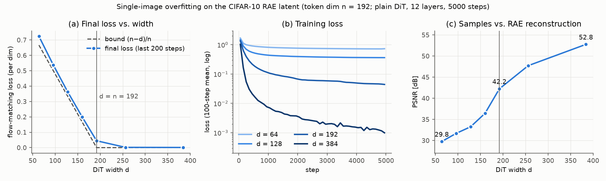
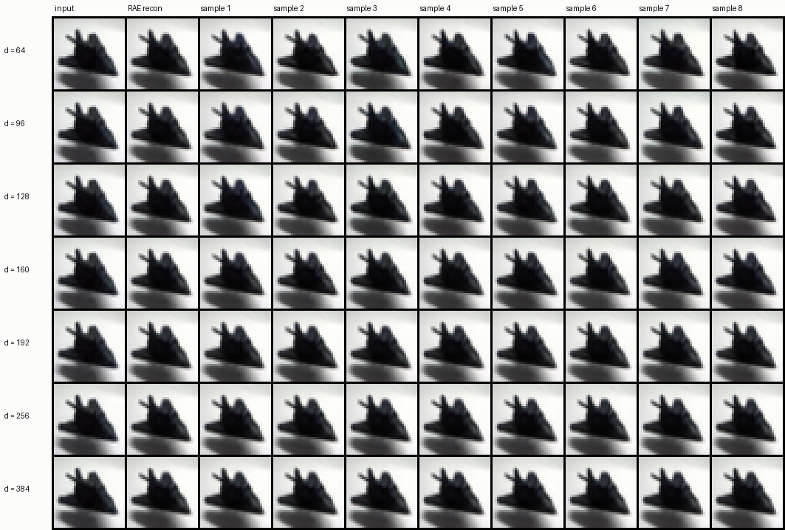

# 03. Single-image overfitting: DiT width vs. token dimension (RAE Sec. 4.1, Table 3)

- **Status:** done
- **Paper:** Sec. 4.1, Table 3, Fig. 3, Theorem 1

## Goal

The paper reports that a diffusion transformer whose width d is smaller than the RAE token dimension n cannot fit even a single
image, and shows that for a single image the flow-matching loss (mean per dimension) cannot go below **(n − d)/n** (Theorem 1).
We check this on the CIFAR-10 RAE.

## Setup

| Item | Value |
|---|---|
| Image | one CIFAR-10 train image (`airplane/00029.png`) |
| Latent | Tiny encoder (n = 192), normalized with the Stage 2 statistics |
| Model | plain DiT without the DDT head (`LightningDiT`), 12 layers, patch 1, 32 dims per head |
| Width d | 64, 96, 128, 160, 192, 256, 384 |
| Training | the same latent repeated 256 times per batch, only t and the noise vary; AdamW (lr 2e-4), 5000 steps, bf16 |
| Loss | velocity MSE (mean per dimension), time shift 1.73 |
| Sampling | ODE (Euler, 50 steps), 8 samples; ViT-XL decoder with GAN |

## Results



| Width d | Final loss (mean of the last 200 steps) | Bound (n − d)/n | PSNR of samples vs. RAE reconstruction |
|---|---|---|---|
| 64 | 0.724 | 0.667 | 29.8 dB |
| 96 | 0.537 | 0.500 | 31.7 dB |
| 128 | 0.362 | 0.333 | 33.3 dB |
| 160 | 0.200 | 0.167 | 36.4 dB |
| 192 | 0.045 | 0 | 42.2 dB |
| 256 | 0.0019 | 0 | 47.7 dB |
| 384 | 0.0011 | 0 | 52.8 dB |

- **For d < n the loss stops just above the bound (+0.03 to 0.06); for d ≥ n it goes to almost 0.** This reproduces Table 3
  and Theorem 1 of the paper.
- d = n (192) converges, but slowly (the loss is still decreasing at 5000 steps). In the paper, DiT-S × DINOv2-S (d = n = 384)
  is also higher than the others (3.6e-2).
- The PSNR of the samples against the RAE reconstruction rises monotonically with width (29.8 dB at d = 64 to 52.8 dB at d = 384).
  For d ≥ 192, the PSNR against the original image reaches 34.4 dB, the same as the RAE reconstruction.

## Difference from the paper: little visible degradation



In Fig. 3 of the paper, samples with d < n are visibly degraded. Here, even d = 64 looks almost like the original (the
difference shows up in PSNR). Possible reasons, none of them verified:

- Low resolution: one token covers only 4×4 pixels (16×16 in the paper's 256px setting).
- A noise-robust decoder: the decoder is trained with noise added to the latent (σ up to 0.8). The error left by a narrow
  model is isotropic over n − d directions and resembles this noise.
- A simple image (a dark airplane on a light background).

## Reproduce

```bash
PYTHONPATH=src uv run python scripts/overfit_single_image.py \
  --config configs/stage2/sampling/CIFAR10/DiTDH-S_dinov2-r0_decXL-gan.yaml \
  --widths 64 96 128 160 192 256 384 --steps 5000 --out samples/overfit/tiny_n192
uv run python scripts/plot_overfit.py samples/overfit/tiny_n192 docs/figures/03_single_image_overfit/overfit_tiny_n192
```

A few to about fifteen minutes per width. The numbers are written to `samples/overfit/tiny_n192/results.json`.
