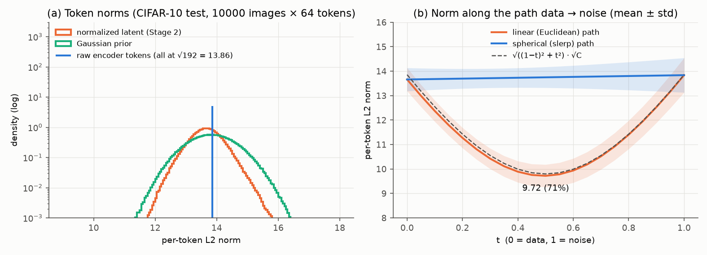

# 04. Latent geometry: does the latent lie on a sphere? (premise of RJF)

- **Status:** done
- **Paper:** Learning on the Manifold (RJF, [arXiv 2602.10099](https://arxiv.org/abs/2602.10099)), Fig. 2 and 3

## Goal

RJF points out that representation-encoder features lie on a hypersphere, and that flow matching with a straight path between
data and noise passes through the inside of the sphere (a low-density region). We check whether this premise holds for the
latent of the CIFAR-10 RAE. No training is involved.

## Setup

- 10,000 CIFAR-10 test images × 64 tokens, Tiny encoder (C = 192).
- Per-token L2 norms of three kinds of latent: the encoder output (after a LayerNorm without affine parameters), the Stage 2
  input (after per-dimension mean / variance normalization), and Gaussian noise.
- Data (normalized) and noise are connected by the straight path x_t = (1 − t)x + tε and by spherical interpolation (slerp, with
  the radius interpolated linearly), and the norm is tracked along each path.

## Results



| Latent | Mean token norm | Std / mean | Range |
|---|---|---|---|
| Encoder output (after LN) | 13.856 | 0.0006% | 13.855–13.856 |
| Stage 2 input (after normalization) | 13.66 | 3.5% | 10.96–16.88 |
| Gaussian noise | 13.84 | 5.1% | 10.59–17.19 |

- **By construction, the encoder output lies exactly on the sphere of radius √192 = 13.856.** A LayerNorm without affine
  parameters gives every token zero mean and unit variance over channels, so its norm is √C (√768 ≈ 27.7 for DINOv2-B in the
  official RAE, the value quoted in the RJF paper).
- The Stage 2 input and the noise both concentrate around the same radius (spread 3.5% and 5.1%).
- Data and noise are nearly orthogonal (cosine similarity mean 0.00, std 0.07). **On the straight path, the norm therefore
  shrinks by √((1 − t)² + t²) and reaches 9.72 (71% of the endpoints) at t = 0.5, inside the sphere.** Along slerp the norm stays
  almost constant.
- How much this hurts Stage 2 generation has not been measured yet (to be tested in the RJF follow-up).

## Reproduce

```bash
PYTHONPATH=src uv run python scripts/latent_geometry.py \
  --config configs/stage2/sampling/CIFAR10/DiTDH-S_dinov2-r0_decXL-gan.yaml --out docs/figures/04_latent_geometry/latent_geometry_tiny
```

The numbers (norm statistics, mean and std of the norm along each path) go to `docs/figures/04_latent_geometry/latent_geometry_tiny.json`.
Takes a few minutes.
