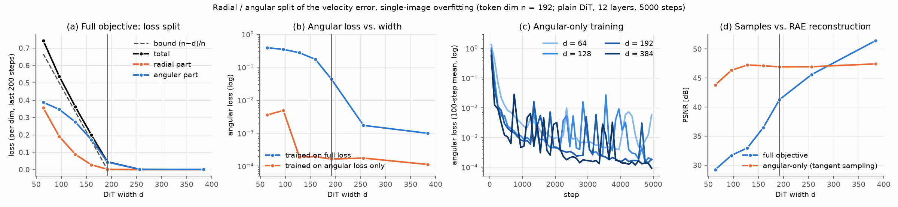

# 05. Radial and angular parts of the loss in single-image overfitting (RJF Fig. 4)

- **Status:** done
- **Paper:** Learning on the Manifold (RJF, [arXiv 2602.10099](https://arxiv.org/abs/2602.10099)), Eq. 4 and Fig. 4

## Goal

In [03](03_single_image_overfit.md), a DiT narrower than the token dimension could not fit a single image and its loss stopped
at the RAE bound (n − d)/n. RJF attributes this to a geometric conflict rather than to insufficient width: splitting the loss
into radial and angular parts, **the angular part alone converges even with a narrow model**. We check this on the CIFAR-10 RAE.

## Setup

- As in [03](03_single_image_overfit.md): same image, latent n = 192, plain 12-layer DiT, widths 64–384, 5000 steps, bf16.
- The velocity error e = v_θ − u is split per token into its component along x_t (x_t / ‖x_t‖, the radial part) and the rest
  (the angular part). The paper does not define the radial direction; we use the direction of x_t. Averaged per dimension,
  radial + angular = total loss.
- Two objectives: **full** (plain flow matching, as in 03, with the split logged) and **angular** (the angular part only).
- A model trained on the angular objective has not learned the radial velocity, so sampling integrates only the tangential
  component of the velocity.

## Results



Means of the last 200 steps (per dimension). Sample PSNR is the mean over 8 samples against the RAE reconstruction:

| d | Full: total | Full: radial | Full: angular | Bound (n−d)/n | Angular: angular | Angular: radial (not trained) | Sample PSNR full / angular |
|---|---|---|---|---|---|---|---|
| 64 | 0.743 | 0.356 | 0.387 | 0.667 | **0.0036** | 3.13 | 29.2 / **43.8** |
| 96 | 0.537 | 0.190 | 0.347 | 0.500 | **0.0049** | 3.12 | 31.7 / **46.3** |
| 128 | 0.362 | 0.088 | 0.274 | 0.333 | **0.0002** | 3.20 | 33.0 / **47.2** |
| 160 | 0.200 | 0.027 | 0.172 | 0.167 | **0.0002** | 3.22 | 36.5 / **47.1** |
| 192 | 0.045 | 0.002 | 0.043 | 0 | 0.0002 | 3.16 | 41.3 / 46.9 |
| 256 | 0.0019 | 0.0001 | 0.0017 | 0 | 0.0002 | 3.20 | 45.6 / 47.0 |
| 384 | 0.0011 | 0.0001 | 0.0010 | 0 | 0.0001 | 3.22 | **51.5** / 47.4 |

Numbers: `docs/figures/05_radial_angular/radial_angular_tiny_n192.json`; samples of the angular runs:
`radial_angular_tiny_n192_samples.png`.

- **With the full objective and d < n, both the radial and the angular parts keep an error** (0.36 and 0.39 at d = 64).
  As d approaches n, the radial part vanishes first and the angular part remains (0.03 and 0.17 at d = 160).
- **With the angular objective, the loss goes down to 0.004 even at d = 64** (vs. 0.39 for the angular part under the full
  objective), and to 0.0002 for d ≥ 128, almost independent of width. **This reproduces the RJF claim that the angular part
  converges even with a narrow model.**
- For d < n, the angular samples are also much closer to the RAE reconstruction (29.2 → 43.8 dB at d = 64). For d ≥ 256, however,
  the full objective is better and the angular one saturates around 47 dB (latent MSE around 0.007). Because angular sampling
  integrates only the tangential velocity, each token keeps the norm of the initial noise; we think the remaining norm mismatch
  with the data causes the plateau (RJF avoids this by rescaling the output to the radius R).

## Interpretation (caveat)

For a single image, the decrease of the angular loss has an almost trivial explanation. With data z, noise ε and
x_t = (1 − t)z + tε, the target velocity is u = ε − z = (x_t − z)/t. Removing its component along x_t leaves the angular part
−(I − r rᵀ) z / t, with r = x_t / ‖x_t‖. **The model can make the angular loss zero by outputting the constant vector −z/t**,
which lies in a one-dimensional subspace and is representable at any width d.

The full target, in contrast, contains x_t / t. The noise ε spans all n dimensions, so a model whose output is confined to a
d-dimensional subspace (by its final linear layer) cannot represent it, and the bound (n − d)/n remains (RAE Theorem 1). In
the angular loss, the projection onto the direction of x_t takes over this "part proportional to x_t".

The result therefore shows that aligning the geometry removes the width problem, but in the single-image setting this is nearly
trivial. Whether the same holds when training on many images (Stage 2) is not answered by this experiment.

## Reproduce

```bash
for o in full angular; do
  PYTHONPATH=src uv run python scripts/overfit_single_image.py \
    --config configs/stage2/sampling/CIFAR10/DiTDH-S_dinov2-r0_decXL-gan.yaml \
    --widths 64 96 128 160 192 256 384 --steps 5000 --objective $o --out samples/overfit/tiny_n192_$o
done
uv run python scripts/plot_radial_angular.py samples/overfit/tiny_n192_full samples/overfit/tiny_n192_angular \
  docs/figures/05_radial_angular/radial_angular_tiny_n192
```
