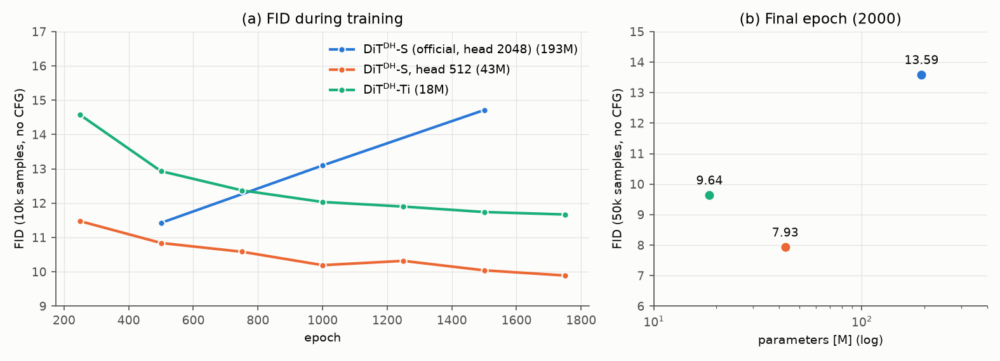
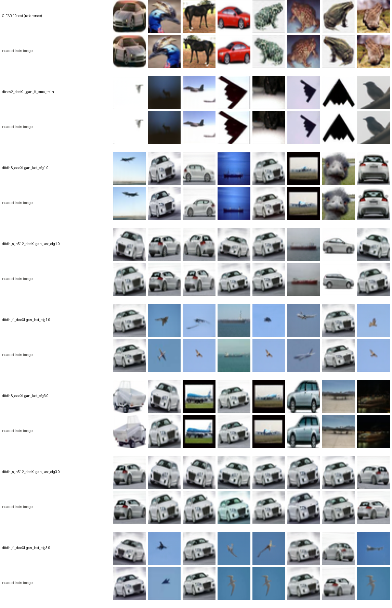

# 07. Stage 2 model size: smaller DiT<sup>DH</sup> for the CIFAR-10 latent

- **Status:** done
- **Paper:** Fig. 6 (DiT<sup>DH</sup>-S / B / L / XL), Appendix Table 17 (DDT head width vs. encoder)

## Goal

The official DiT<sup>DH</sup>-S used in [02](02_stage2_ditdh_s.md) has a 2-layer, 2048-wide DDT head, chosen for ImageNet with
DINOv2-B (token dim n = 768, head ≈ 2.7n). With our token dim n = 192 the head is about 11n and holds about 80% of the 193M
parameters. We check whether smaller models suffice: (1) shrinking the head to the paper's ratio (512 ≈ 2.7n), and
(2) shrinking the body as well.

## Setup

Same recipe as [02](02_stage2_ditdh_s.md) (2000 epochs, batch 512, bf16, latent and transport unchanged) except the model;
FID (10k samples, no CFG) every 250 epochs.

| Model | Body (width, depth, heads) | DDT head (width, depth, heads) | Params |
|---|---|---|---|
| DiT<sup>DH</sup>-S (official, [02](02_stage2_ditdh_s.md)) | 384, 12, 6 | 2048, 2, 16 | 193.4M |
| DiT<sup>DH</sup>-S, 512 head | 384, 12, 6 | 512, 2, 4 | 42.8M |
| DiT<sup>DH</sup>-Ti | 192, 12, 3 | 512, 2, 4 | 18.5M |

- 02 vs. the 512 head: effect of the head width (body fixed).
- 512 head vs. Ti: effect of the body width (head fixed). The Ti body equals n, the same body / n ratio as the paper's default
  (DiT<sup>DH</sup>-B with DINOv2-B).

Configs: `configs/stage2/training/CIFAR10/DiTDH-{Ti,S-h512}_dinov2-r0_decXL-gan.yaml`

## Results



FID during training (10k samples, no CFG) and after training (final epoch 2000, EMA, 50k samples, no CFG; same protocol as
[02](02_stage2_ditdh_s.md)):

| Model | Params | 250 | 500 | 750 | 1000 | 1250 | 1500 | 1750 | **Final, 50k** |
|---|---|---|---|---|---|---|---|---|---|
| DiT<sup>DH</sup>-S (official, head 2048) | 193.4M | – | 11.42 | – | 13.10 | – | 14.71 | – | 13.59 |
| DiT<sup>DH</sup>-S, head 512 | 42.8M | 11.47 | 10.84 | 10.58 | 10.19 | 10.32 | 10.04 | 9.89 | **7.94** |
| DiT<sup>DH</sup>-Ti | 18.5M | 14.57 | 12.93 | 12.37 | 12.03 | 11.90 | 11.74 | 11.67 | 9.64 |

Final training loss: 0.233 (official S), 0.350 (head 512), 0.413 (Ti). Numbers: `docs/figures/07_stage2_model_size/fid.json`.

- **Shrinking the DDT head from 2048 to 512 improves FID** (50k: 13.59 → 7.94) with 4.5× fewer parameters and about 2.5× faster training.
- **The smaller models keep improving until the end of training**, while the official S is best at epoch 500 and then gets worse.
  The official S also reaches the lowest training loss, so we read its decline as overfitting the 50k training images,
  driven by the oversized head.
- **Shrinking the body as well (384 → 192, Ti) costs some FID** (7.94 → 9.64) but is still clearly better than the official S
  with about 1/10 of its parameters.
- In terms of the two readings of the paper's Table 17 (best head width proportional to the token dim, or fixed around 2048),
  this supports the former on CIFAR-10: a head of about 2.7n works better than 2048 ≈ 11n.

### With CFG 3.0

Final epoch, 50k samples, FID against CIFAR-10 train:

| Model | No CFG | CFG 3.0 |
|---|---|---|
| DiT<sup>DH</sup>-S (official, head 2048) | 13.59 | 23.50 |
| DiT<sup>DH</sup>-S, head 512 | **7.94** | **14.34** |
| DiT<sup>DH</sup>-Ti | 9.64 | 15.71 |

The ranking is the same with CFG 3.0, and CFG 3.0 makes every model worse (as in [02](02_stage2_ditdh_s.md)).

CFG scale sweep on the 512-head model (50k samples):

| CFG scale | 1.0 (none) | 1.25 | 1.5 | 2.0 | 3.0 |
|---|---|---|---|---|---|
| FID | **7.94** | 8.15 | 9.02 | 11.06 | 14.34 |

FID gets monotonically worse with guidance, even at 1.25. Note that the official RAE configs do not use CFG 3.0 either:
`DiTDHXL-DINOv2-B.yaml` uses no guidance (scale 1.0) and the best official setting uses AutoGuidance (scale 1.42), which needs a
separately trained guidance model and is not tried here.

### Memorization

`scripts/memorization.py` searches, for every sample, the nearest training images in pixel space (L2; train 50k plus their
horizontal flips, since Stage 2 trains with flips; an image and its flip count as one). All 50k samples per model are scored.
Let d1, d2 be the distances to the nearest and second-nearest training image.

- **Main criterion: Gu et al.** ([On Memorization in Diffusion Models](https://arxiv.org/abs/2310.02664)): a sample is memorized
  if d1 / d2 < 1/3 (an empirical threshold from Yoon et al. 2023). Gu et al. report 0% for EDM trained on the full CIFAR-10 (50k).
- **Supplementary: Carlini et al.** ([Extracting Training Data from Diffusion Models](https://arxiv.org/abs/2301.13188),
  Sec. 5.1, CIFAR-10): score = d1 / (α · mean distance to the n nearest training images), α = 0.5, n = 50. The paper gives no
  numeric threshold; we count score < 1 (d1 below half the mean 50-NN distance) and the distinct training images matched. We use
  it because the Gu criterion is 0% for all our models and cannot compare them.

References: RAE reconstructions of train images (what perfect memorization of the latent would give, since the decoder cannot
reproduce pixels exactly) and CIFAR-10 test images (real images that were not trained on).

| | Gu: d1/d2 < 1/3 | Carlini: score < 1 | Carlini: distinct train images | Median d1 |
|---|---|---|---|---|
| RAE reconstructions of train (50k) | 98.99% | 100% | 50,000 | 1.44 |
| CIFAR-10 test (10k) | 0.19% | 1.49% | 149 | 9.11 |
| Official S, no CFG | **0%** | 0.250% | 113 | 8.43 |
| Head 512, no CFG | **0%** | 0.026% | 13 | 8.96 |
| Ti, no CFG | **0%** | 0.002% | 1 | 8.92 |
| Official S, CFG 3.0 | **0%** | 0.318% | 136 | 8.16 |
| Head 512, CFG 3.0 | **0%** | 0.046% | 19 | 8.66 |
| Ti, CFG 3.0 | **0%** | 0.006% | 3 | 8.59 |



(For each input, the 8 samples with the lowest Carlini score, above their nearest training images.)

- **By the Gu criterion, no model memorizes** (0% for all), the same as EDM on the full CIFAR-10 in Gu et al. The criterion
  itself works: it flags 99% of the reconstructions.
- **The supplementary Carlini score still shows a difference between the models.** The official S yields about 10× more
  near-copies than the 512-head model and about 100× more than Ti (113 vs. 13 vs. 1 distinct training images without CFG), and
  its closest samples are visibly copies of varied training images (an airplane, a ship, a framed airplane photo, an emu, cars).
  The smaller models match almost only one heavily duplicated training image (the white car) plus a few low-content sky images.
  The ranking does not depend on the threshold (distinct training images, no CFG):

  | Threshold on the Carlini score | 0.6 | 0.8 | **1.0** | 1.2 |
  |---|---|---|---|---|
  | Official S | 10 | 50 | **113** | 293 |
  | Head 512 | 0 | 4 | **13** | 35 |
  | Ti | 0 | 0 | **1** | 11 |
  | CIFAR-10 test (10k, reference) | 19 | 61 | **149** | 237 |

- The Gu criterion misses these near-copies because CIFAR-10 contains clusters of near-duplicate training images, which also make
  d2 small (as noted in [arXiv 2601.19285](https://arxiv.org/abs/2601.19285)). The CIFAR-10 test set itself scores 1.49% on the
  Carlini score for the same reason.
- CFG 3.0 moves every model closer to the training set.

## Caveats

- One seed per model. The 10k FIDs during training vary by about ±0.15 between neighbouring evaluations (e.g. head 512 at
  epochs 1000 / 1250), so small differences are not meaningful; the 50k differences here are much larger.
- The final 50k FID is lower than the 10k FIDs during training also because of the sample count (FID is biased upward for fewer samples).
- All runs use the same 2000-epoch schedule; the official S might do better with early stopping (its 10k FID at epoch 500 is 11.42),
  but even that is worse than both smaller models at the end.

## Reproduce

```bash
scripts/train_stage2.sh configs/stage2/training/CIFAR10/DiTDH-Ti_dinov2-r0_decXL-gan.yaml ditdh_ti_decXLgan
scripts/train_stage2.sh configs/stage2/training/CIFAR10/DiTDH-S-h512_dinov2-r0_decXL-gan.yaml ditdh_s_h512_decXLgan
scripts/eval_stage2.sh configs/stage2/sampling/CIFAR10/DiTDH-Ti_dinov2-r0_decXL-gan.yaml ditdh_ti_decXLgan_last_cfg1.0 1.0
scripts/eval_stage2.sh configs/stage2/sampling/CIFAR10/DiTDH-S-h512_dinov2-r0_decXL-gan.yaml ditdh_s_h512_decXLgan_last_cfg1.0 1.0
uv run python scripts/plot_stage2_size.py docs/figures/07_stage2_model_size/fid.json docs/figures/07_stage2_model_size/fid
# CFG 3.0: the same eval_stage2.sh commands with scale 3.0; memorization (needs samples/<name>_ema_train.npz from eval_stage1.sh):
PYTHONPATH=src uv run python scripts/memorization.py --out docs/figures/07_stage2_model_size/memorization \
  samples/dinov2_decXL_gan_ft_ema_train.npz samples/stage2/{ditdhS,ditdh_s_h512,ditdh_ti}_decXLgan_last_cfg{1.0,3.0}.npz
```

Training takes about 9 h (Ti) and 13 h (head 512); each 50k evaluation takes about 7 minutes.
